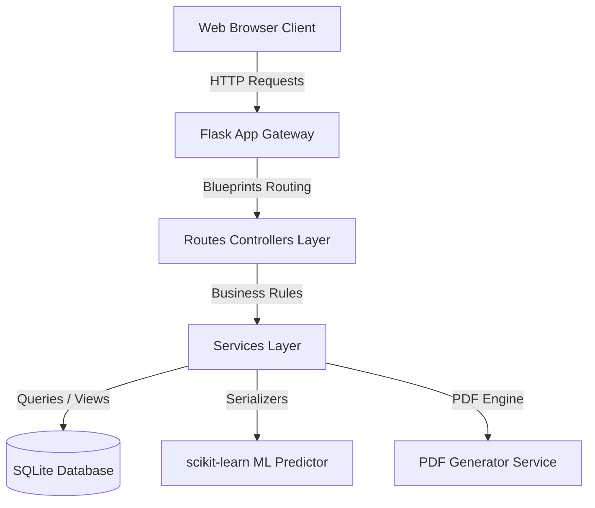

# Smart Student Management System 🎓


A modular, multi-tier **Smart Student Management System Portal** designed to streamline academic operations, attendance logging, examinations, fee processing, analytics, and dropout risk prediction.

---

## 🌟 Key Features

### 👥 Multi-Role Portals
- **Administrator Portal**: Comprehensive system control, user management, course setup, department oversight, and system logs.
- **Faculty Portal**: Class scheduling, mark entry, attendance tracking, and student progress monitoring.
- **Student Portal**: Academic summary dashboard, timetable, fee payment status, hall ticket download, and exam transcript generation.
- **Parent Portal**: Real-time insights into student attendance, grade performance, and fee status.

### 🧠 Machine Learning & Predictive Analytics
- **Dropout Risk Indicator**: Embedded `scikit-learn` classifier model predicting student dropout risks based on academic marks history and attendance trends.
- **Performance Analytics**: SQL views (`student_academic_summary`) optimizing heavy dataset aggregation for real-time reporting.

### 📋 Core Academic Modules
- **Authentication**: Secure scrypt-hashed password hashing, role-based authorization decorators, and session lifetime protection.
- **Student Registry & Directory**: Emergency contact records, student profile directories, and ID card badge visualizer.
- **Attendance Logging**: Real-time present/absent checks with automated threshold reporting.
- **Examinations & Transcripts**: Exam schedule publication, makeup exam applications, printable hall tickets, and downloadable marksheets.
- **Fee Management & Invoicing**: Automated tuition fee ledger generation triggers, online payment workflow simulation, and PDF receipt downloads.
- **AI Consulting Chatbot**: Interactive query interface for instant academic queries and performance summaries.

---

## 🏗 System Architecture



---

## 🛠 Tech Stack

- **Backend**: Python 3.10+, Flask, Flask-CORS, `python-dotenv`, Firebase Admin SDK
- **Machine Learning**: `scikit-learn`, `pandas`, `numpy`
- **Frontend**: HTML5, Vanilla CSS3 (Custom Design System with dark mode support & responsive layouts), JavaScript (ES6+)
- **Database**: SQLite3 (triggers, procedures, relational views)
- **Containerization**: Docker & Docker Compose

---

## 📂 Project Structure

```
student-management-system/
│
├── backend/
│   ├── ai/                      # ML model training & prediction scripts
│   ├── config/                  # Database & Firebase configurations
│   ├── models/                  # Data models (Student, Faculty, Exam, Fees, etc.)
│   ├── routes/                  # Modular Flask blueprints
│   ├── services/                # Business logic & service adapters
│   ├── utils/                   # Authentication, PDF generation & validators
│   ├── app.py                   # Main Flask application entry point
│   └── requirements.txt         # Python dependencies
│
├── database/
│   ├── schema.sql               # Relational database schema
│   ├── seed.sql                 # Sample data generator scripts
│   ├── procedures.sql           # SQL stored procedures
│   └── triggers.sql             # Tuition fee & log ledger triggers
│
├── deployment/
│   ├── Dockerfile               # Production Docker image configuration
│   └── docker-compose.yml       # Orchestration setup
│
├── docs/
│   └── SRS/                     # Software Requirements Specifications
│
├── frontend/
│   ├── assets/                  # Images & static assets
│   ├── components/              # Shared UI components (navbar, sidebar, modal, footer)
│   ├── css/                     # Styling stylesheets & responsive design
│   ├── js/                      # Frontend API integrations & interaction scripts
│   └── pages/                   # Admin, Faculty, Student, & Parent dashboards
│
├── tests/                       # Unit & integration test suites
├── .env.example                 # Environment variables template
└── .gitignore                   # Excluded files list
```

---

## 🚀 Getting Started

### Prerequisites
- Python 3.10 or higher
- Git
- Pip (Python Package Installer)

### 1. Clone the Repository
```bash
git clone https://github.com/radkearyan/student-management-system.git
cd student-management-system
```

### 2. Set Up Virtual Environment
```bash
# Windows
python -m venv venv
venv\Scripts\activate

# macOS/Linux
python3 -m venv venv
source venv/bin/activate
```

### 3. Install Dependencies
```bash
pip install -r backend/requirements.txt
```

### 4. Configure Environment Variables
Copy `.env.example` to `.env` in the root directory:
```bash
cp .env.example .env
```
*(Optionally adjust SMTP, Flask secret keys, or database options in `.env`)*

### 5. Run the Application
```bash
python backend/app.py
```
Open your browser and navigate to `http://localhost:5000`.

---

## 🐳 Docker Setup

Run the application using Docker Compose:

```bash
cd deployment
docker-compose up --build
```
The server will be available at `http://localhost:5000`.

---

## 🧪 Running Tests

Execute the automated test suite covering routes, services, database procedures, and UI integration:

```bash
pytest tests/
```

---

## 📄 License

This project is licensed under the MIT License - see the [LICENSE](LICENSE) file for details.
