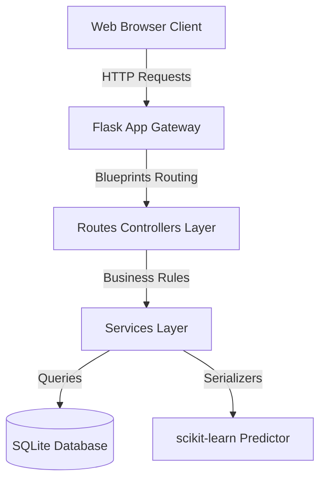

# Software Requirements Specification (SRS)
## Smart Student Management System Restructuring

---

### 1. Introduction
This document details the software specifications for the restructured **Student Management System Portal**. The project is evolved from a flat single-file prototype into a premium, modular multi-tier application.

### 2. Architecture & Design Principles
The portal leverages a clean separation of concerns:
1. **Frontend (Static Single/Multi Page Layouts)**: Served directly via Flask, using pure HTML, Vanilla CSS modules, and component-based script loaders.
2. **Backend REST APIs**: Modular Flask blueprint routing layer mapping SQL logic to services.
3. **Database (SQLite)**: Fully relational schema with embedded views, tuition fee generation triggers, and transaction log ledgers.
4. **Machine Learning Service**: Python scikit-learn classifier model predicting student dropout risk indicators based on grading marks histories.

### 3. Functional Modules
- **Authentication**: Session login, secure scrypt hashed registrations, password adjustments.
- **Student Registry**: Profile directory lists, emergency contact edits, avatar upload folders, and ID card badge visualizers.
- **Attendance**: Faculty logs checks, present/absent logs logs.
- **Examinations**: Exam listings, marks submissions, supplementary makeup application registries, printable hall tickets admit passes, printable transcripts marksheets.
- **Fees**: Tuition bills generation triggers, simulated debit/credit card gateway checkouts, fee receipt prints.
- **Feedback**: Star-based quality evaluations surveys logs reports.
- **AI Consulting Chatbot**: Contextual chatbot replying queries regarding academic results and indicators.

### 4. Non-Functional Requirements
- **Performance**: Heavy database averages are optimized using the `student_academic_summary` view to avoid loop queries.
- **Security**: Authentication checks roles on client transition routes, server routes are protected using python decorators.
- **Deployment**: Full Docker container configurations.
